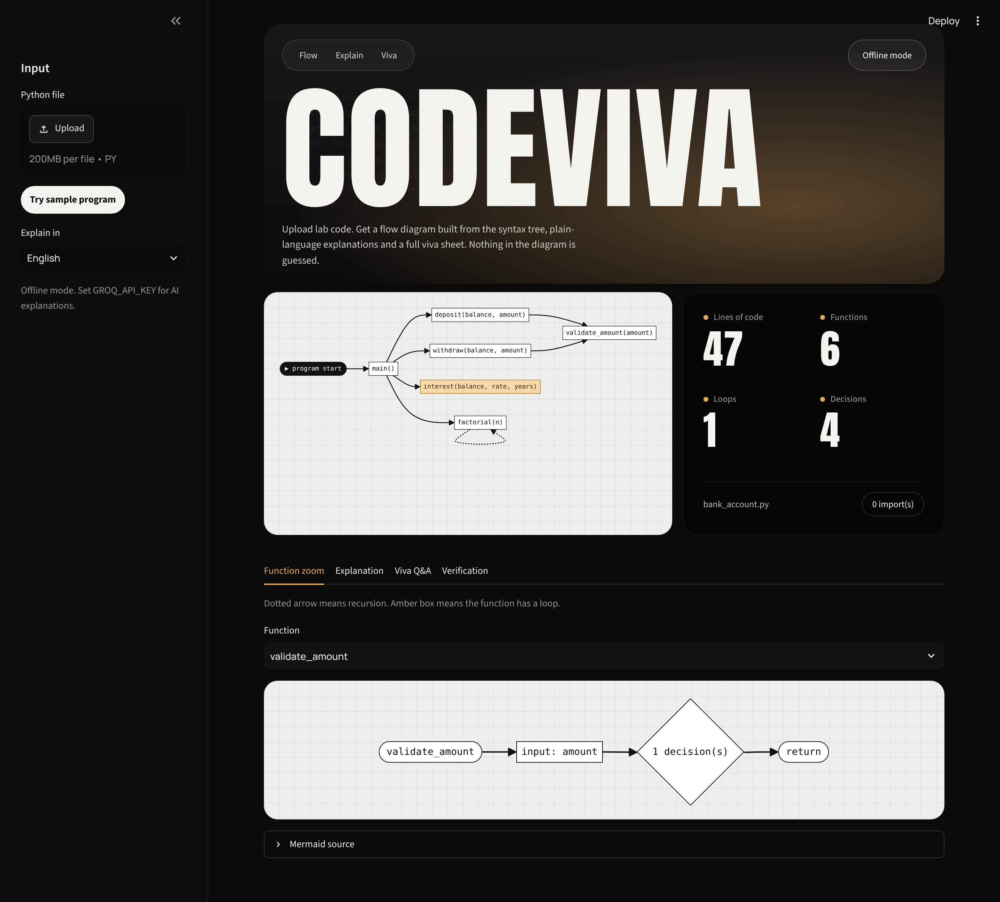
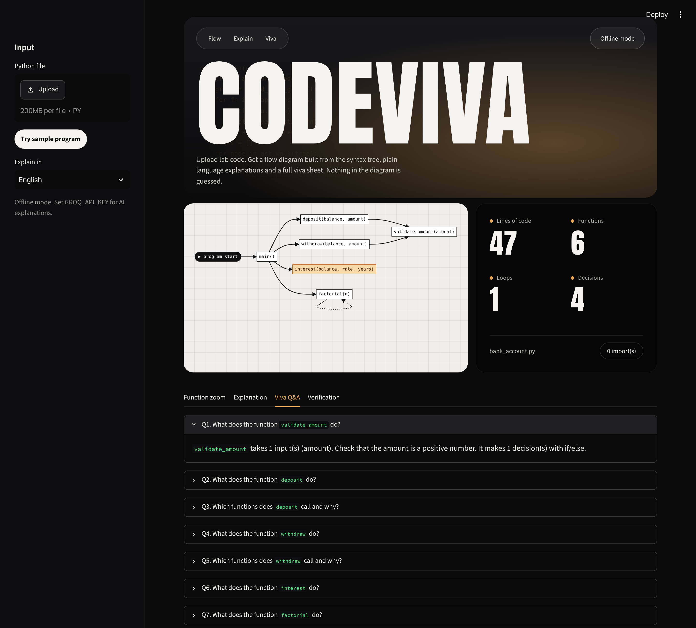
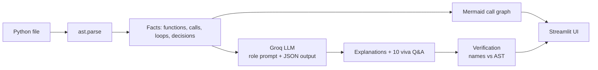
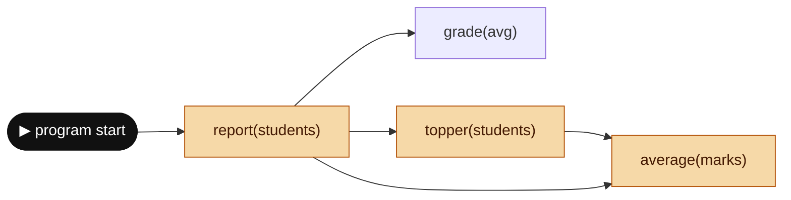

# CodeViva

**AI code explainer for students.** Upload a Python lab program and get a flow diagram, plain-language explanations and a ten-question viva sheet. The structure of the code comes from the Abstract Syntax Tree (AST), not from the language model, so the diagram cannot invent functions.


[](https://github.com/sanket1035/codeviva/actions/workflows/ci.yml)



## Why this exists

LLMs explain code well but hallucinate: they can describe a function that is not in the file. For a student preparing a lab viva, a wrong explanation is worse than none. CodeViva splits the work:

| Task | Done by | Why |
|---|---|---|
| Functions, arguments, calls, loops, decisions | Python `ast` module | Deterministic, always correct |
| Flow diagram | Generated as Mermaid text from the AST | Cannot contain functions that do not exist |
| Explanations and viva Q&A | Groq (`openai/gpt-oss-120b` by default) | Language is what LLMs are good at |
| Check of the LLM output | Verification step | Flags any function name not in the code |

## Features

- **Call-graph flow diagram** with loops highlighted and recursion drawn as a dotted self-edge
- **Per-function zoom** showing inputs, decisions, loops, calls and return
- **Explanations in four languages:** English, Hinglish, Hindi, Marathi
- **Ten viva questions with answers**, ordered easy to hard, downloadable as Markdown
- **Hallucination check** that compares every function the LLM names with the real code
- **Offline mode** that works without an API key, using AST-only explanations



## How it works



### Prompt design

- **Role prompt:** the model acts as a patient lab teacher.
- **Grounding:** only the verified facts from the AST are sent as context, with an instruction to mention no other functions.
- **Structured output:** the reply must be a JSON object with a summary, per-function explanations and exactly 10 viva questions.
- **Temperature 0.2** for stable answers; the output language is set in the prompt.

## Example output

The files in [`examples/`](examples) are generated from the four programs in [`samples/`](samples) by `python scripts/generate_examples.py`. They are produced in **offline mode** (AST only, no LLM), so they are reproducible and CI checks that they match the code. LLM-written explanations in English, Hinglish, Hindi or Marathi need a `GROQ_API_KEY` and are not committed here.

| Sample | Functions | Loops | What it shows | Output |
|---|---|---|---|---|
| `bank_account.py` | 6 | 1 | Helper calls, recursion (`factorial`), loop | [`examples/bank_account`](examples/bank_account) |
| `student_grades.py` | 4 | 3 | Dictionaries, if/elif chain, nested calls | [`examples/student_grades`](examples/student_grades) |
| `fibonacci_primes.py` | 5 | 2 | Recursion vs loop, `__main__` guard | [`examples/fibonacci_primes`](examples/fibonacci_primes) |
| `stack_queue.py` | 7 | 1 | Classes and methods (see limitations) | [`examples/stack_queue`](examples/stack_queue) |

Each folder holds `diagram.mmd` (Mermaid, renders on GitHub), `explanation.md` and `viva.md`. Call graph for `student_grades.py`:



## Quick start

```bash
git clone https://github.com/sanket1035/codeviva.git
cd codeviva
pip install -r requirements.txt
cp .env.example .env        # add your free key from console.groq.com
streamlit run app.py
```

Without a `GROQ_API_KEY` the app still runs in offline mode, with AST-based explanations. Use the **Try sample program** button in the sidebar for a quick demo.

### Configuration

| Variable | Default | Purpose |
|---|---|---|
| `GROQ_API_KEY` | none | Enables LLM explanations |
| `GROQ_MODEL` | `openai/gpt-oss-120b` | Groq model ID; change it here when Groq retires a model |
| `MERMAID_JS_URL` | jsDelivr CDN | Override to serve Mermaid locally |

## Project structure

```
codeviva/
  analyzer.py     AST analysis: functions, calls, loops, decisions
  diagram.py      Mermaid generation: call graph and per-function flow
  llm.py          Groq client, prompts, offline fallback
  verify.py       Hallucination check against the AST
  report.py       Markdown rendering of explanations and viva sheets
app.py            Streamlit interface
samples/          Four example lab programs
examples/         Generated diagram, explanation and viva sheet per sample
scripts/          generate_examples.py
tests/            Unit tests
.github/          CI workflow
static/fonts/     Fonts served by Streamlit
```

## Tests

```bash
pytest
```

The suite covers the AST analyzer (arguments, calls, loops, decisions, recursion, async, nested functions, imports, syntax errors), the check that every function name in the LLM text exists in the code, Mermaid generation, and an end-to-end run of every file in `samples/`. A few tests named `known_limitation` pin the behaviour described below, so a change in it shows up in the diff. GitHub Actions runs the suite on Python 3.10 to 3.13 for every push and pull request.

## Live demo

Streamlit Community Cloud can host this app straight from the repository:

1. Sign in at [share.streamlit.io](https://share.streamlit.io) with GitHub and choose **Create app**.
2. Repository `sanket1035/codeviva`, branch `main`, main file `app.py`.
3. Under **Advanced settings > Secrets** add `GROQ_API_KEY = "..."` (optional; without it the demo runs in offline mode).

Add the resulting URL here once the app is deployed.

## Limitations

Where it can be wrong or miss things (each point below is covered by a test or by the committed examples):

- **Python only.** The parser is Python's `ast`; other languages are not supported.
- **Methods are matched by name, not by class.** Two classes that both define `run` appear as one `run` node, and the first definition wins. Method calls on other objects (`stack.push(x)`) are not linked to `push`; only `self.method()` and `cls.method()` are. In `stack_queue.py` this is why `balanced` has no edge to `Stack.push`.
- **The call graph is static.** Calls through variables, callbacks, `getattr`, decorators or `eval` are not resolved.
- **The verification step only checks names written as `name()`.** A function mentioned without parentheses is not checked, and an invented name that equals a Python builtin (for example `sorted()`) passes.
- **Verification checks existence, not correctness.** An explanation can name real functions and still describe them wrongly. The viva answers are not checked for logic.
- **Offline mode is mechanical.** Without an API key the explanations are templates built from the AST, and some programs give fewer than 10 viva questions (6 for `student_grades.py`).
- **Large files** are limited by the model's context window; no chunking is implemented.
- **No accuracy or hallucination rate has been measured.** The tests prove the checks behave as designed on the bundled samples, not how often an LLM hallucinates.

## Roadmap

- Support for C, C++ and Java using tree-sitter
- Measured hallucination rate on a larger set of lab programs
- Class-aware method resolution
- Class and module level diagrams
- Export of the explanation and viva sheet as PDF

## Author

Sanket Chaudhari, B.Tech Artificial Intelligence and Data Science, K.K. Wagh Institute of Engineering Education and Research, Nashik.
