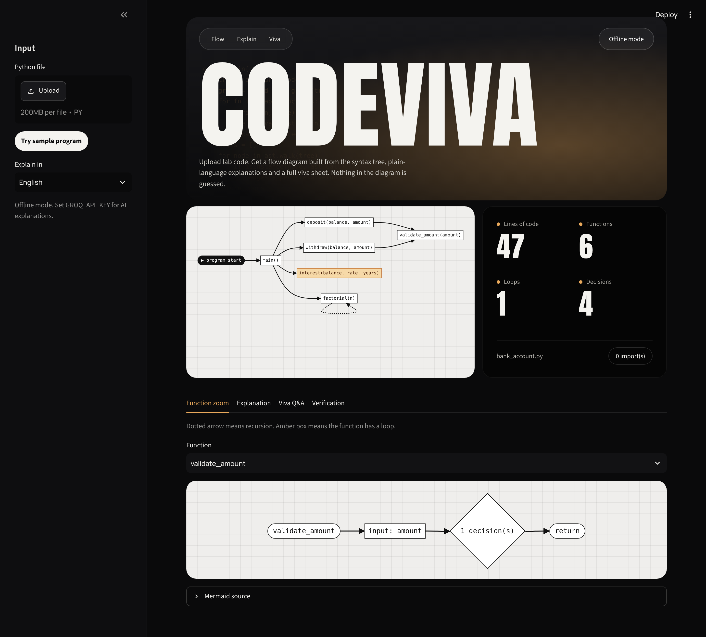
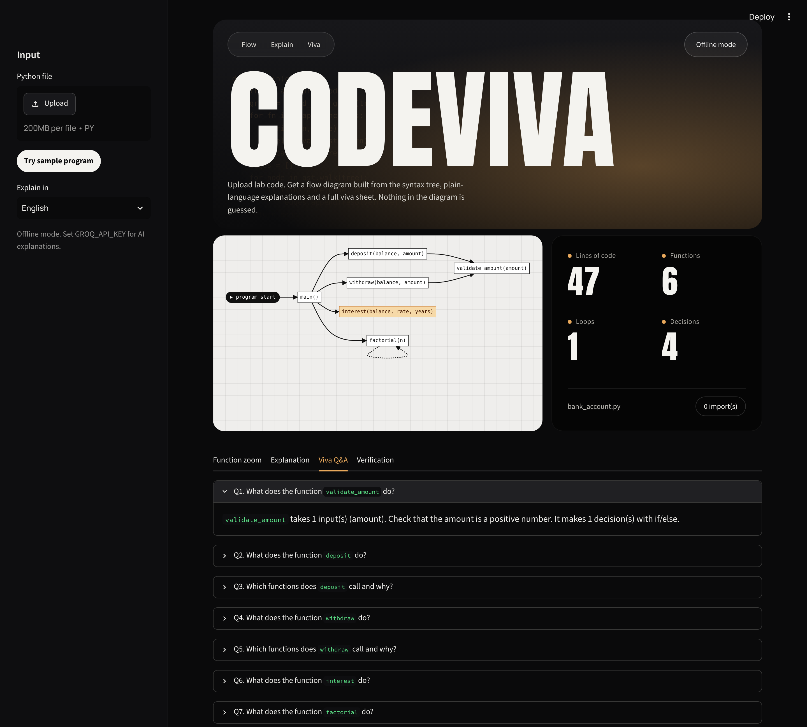
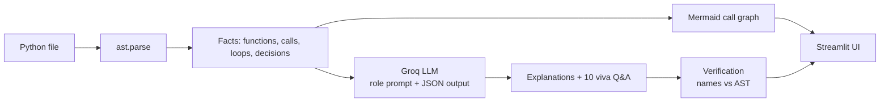

# CodeViva

**AI code explainer for students.** Upload a Python lab program and get a flow diagram, plain-language explanations and a ten-question viva sheet. The structure of the code comes from the Abstract Syntax Tree (AST), not from the language model, so the diagram cannot invent functions.




## Why this exists

LLMs explain code well but hallucinate: they can describe a function that is not in the file. For a student preparing a lab viva, a wrong explanation is worse than none. CodeViva splits the work:

| Task | Done by | Why |
|---|---|---|
| Functions, arguments, calls, loops, decisions | Python `ast` module | Deterministic, always correct |
| Flow diagram | Generated as Mermaid text from the AST | Cannot contain functions that do not exist |
| Explanations and viva Q&A | Groq (Llama 3.3 70B) | Language is what LLMs are good at |
| Check of the LLM output | Verification step | Flags any function name not in the code |

## Features

- **Call-graph flow diagram** with loops highlighted and recursion drawn as a dotted self-edge
- **Per-function zoom** showing inputs, decisions, loops, calls and return
- **Explanations in four languages:** English, Hinglish, Hindi, Marathi
- **Ten viva questions with answers**, ordered easy to hard, downloadable as Markdown
- **Hallucination check** that compares every function the LLM names with the real code
- **Offline mode** that works without an API key, using AST-only explanations



## How it works



### Prompt design

- **Role prompt:** the model acts as a patient lab teacher.
- **Grounding:** only the verified facts from the AST are sent as context, with an instruction to mention no other functions.
- **Structured output:** the reply must be a JSON object with a summary, per-function explanations and exactly 10 viva questions.
- **Temperature 0.2** for stable answers; the output language is set in the prompt.

## Quick start

```bash
git clone https://github.com/sanket1035/codeviva.git
cd codeviva
pip install -r requirements.txt
cp .env.example .env        # add your free key from console.groq.com
streamlit run app.py
```

Without a `GROQ_API_KEY` the app still runs in offline mode, with AST-based explanations. Use the **Try sample program** button in the sidebar for a quick demo.

### Configuration

| Variable | Default | Purpose |
|---|---|---|
| `GROQ_API_KEY` | none | Enables LLM explanations |
| `GROQ_MODEL` | `llama-3.3-70b-versatile` | Model used for explanations |
| `MERMAID_JS_URL` | jsDelivr CDN | Override to serve Mermaid locally |

## Project structure

```
codeviva/
  analyzer.py     AST analysis: functions, calls, loops, decisions
  diagram.py      Mermaid generation: call graph and per-function flow
  llm.py          Groq client, prompts, offline fallback
  verify.py       Hallucination check against the AST
app.py            Streamlit interface
samples/          Example lab program
tests/            Unit tests
static/fonts/     Fonts served by Streamlit
```

## Tests

```bash
pytest
```

The tests cover function and call extraction, loop and recursion detection, Mermaid output and the hallucination check.

## Limitations

- Python only at the moment.
- Verification checks function names, not whether an explanation is logically correct.
- Explanations of very large files depend on the model's context window.
- Tested on a small set of sample programs; no large-scale accuracy evaluation yet.

## Roadmap

- Support for C, C++ and Java using tree-sitter
- Measured hallucination rate on a larger set of lab programs
- Class and module level diagrams
- Export of the explanation and viva sheet as PDF

## Author

Sanket Chaudhari, B.Tech Artificial Intelligence and Data Science, K.K. Wagh Institute of Engineering Education and Research, Nashik.
